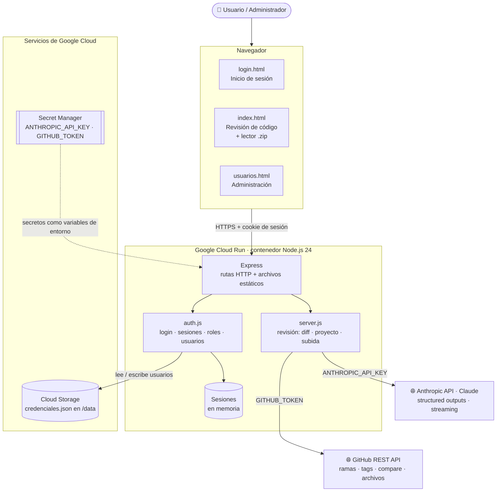
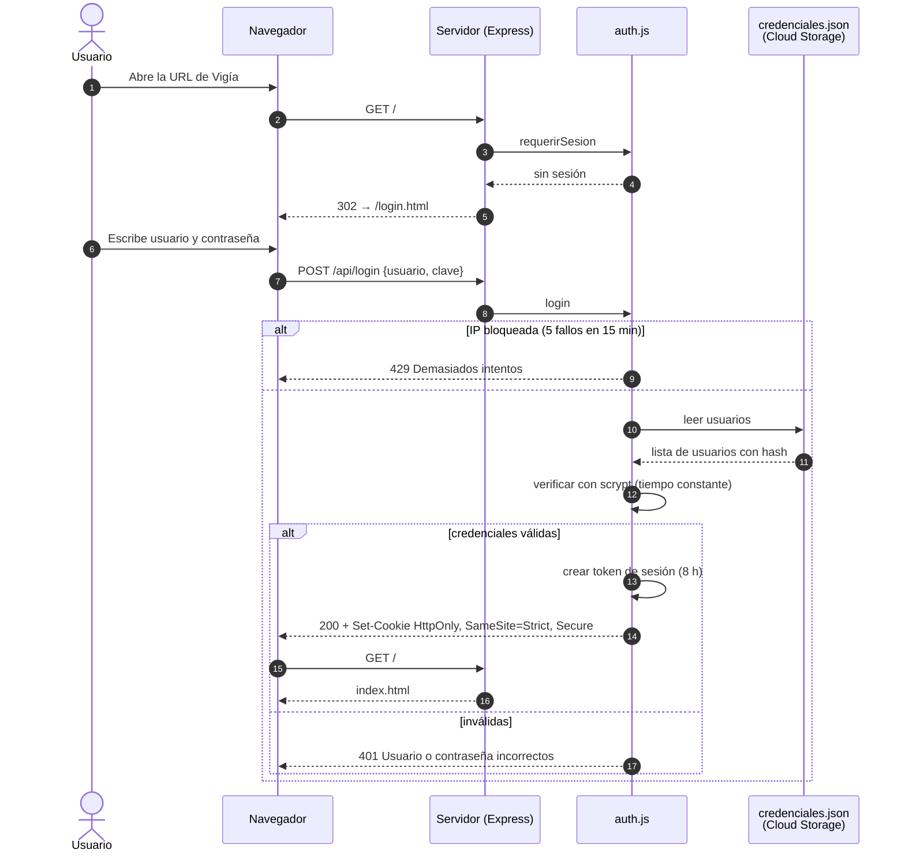
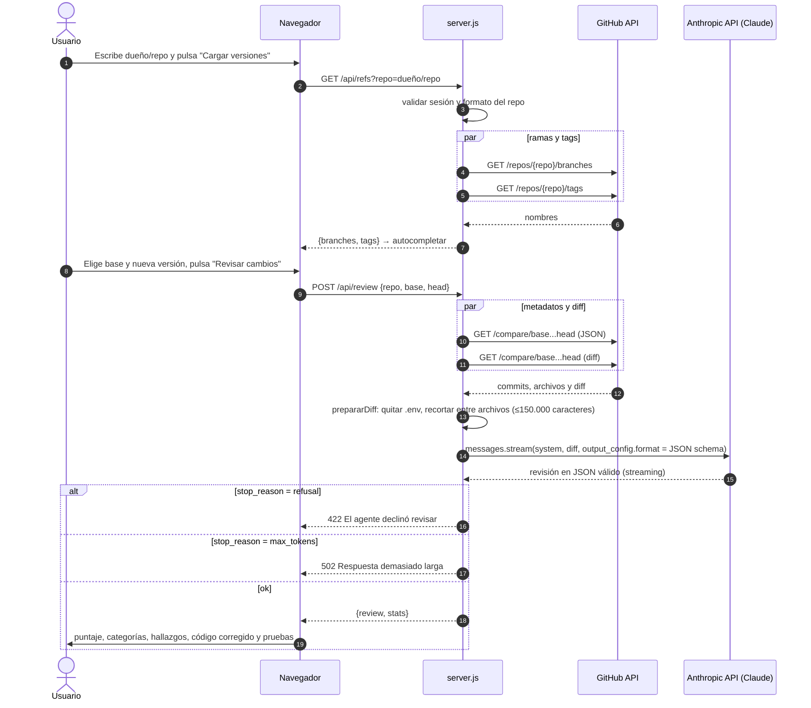
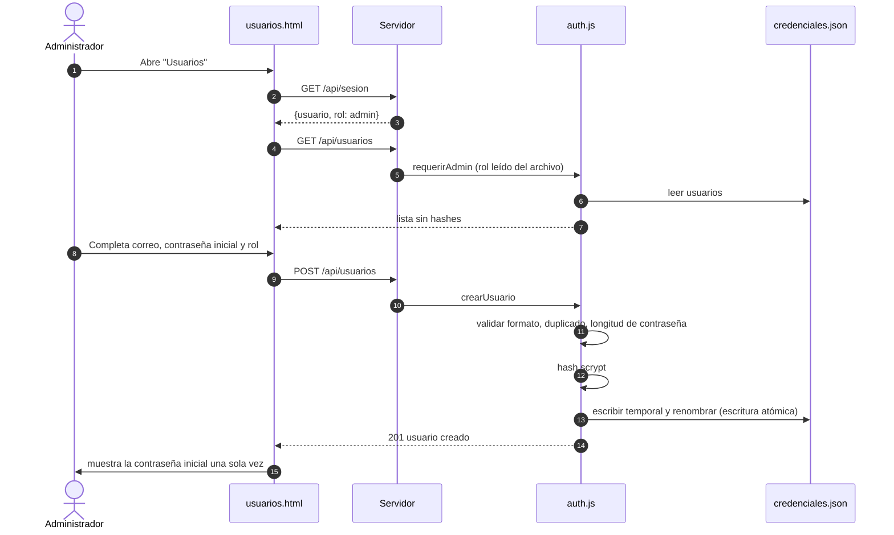

# SPEC – Vigía, agente de revisión de código

| Campo | Valor |
|---|---|
| Versión | 1.3.0 |
| Estado | Implementado y desplegado en Google Cloud Run (piloto) |
| Fecha | 2026-10-10 |
| Responsable | Juan Hernández (juan.hernandezb@terpel.com) |
| Fuente de verdad | Este SPEC y el código en `server.js`, `auth.js` y `public/` |

## 1. Propósito

Vigía es una aplicación web interna que usa Claude (Anthropic) para revisar la calidad del código. Entrega un puntaje de 0 a 100, un veredicto, hallazgos priorizados con código corregido listo para aplicar, archivos corregidos completos y pruebas sugeridas.

## 2. Alcance

### 2.1 Incluido

- Revisión del **diff entre dos versiones** (ramas, tags o commits) de un repositorio de GitHub.
- Revisión de un **proyecto completo** desde una rama de GitHub.
- Revisión de un **proyecto subido** desde el navegador (carpeta, archivos sueltos o .zip).
- **Login** con usuario y contraseña, y **roles** administrador / usuario.
- **Administración de usuarios** desde la web (solo administradores).
- Despliegue en **Google Cloud Run**.

### 2.2 Excluido

- Comentarios automáticos en Pull Requests (webhook de GitHub).
- Historial de revisiones y tendencias por repositorio.
- Integración con el directorio corporativo (Entra ID / SSO).
- Alta disponibilidad con varias instancias.

## 3. Actores

| Actor | Descripción |
|---|---|
| Usuario | Persona autenticada que solicita revisiones de código. |
| Administrador | Usuario que además crea, edita y elimina cuentas. |
| GitHub API | Fuente de ramas, tags, diffs y archivos de los repositorios. |
| Anthropic API (Claude) | Modelo que analiza el código y devuelve la revisión estructurada. |

## 4. Requisitos funcionales

| ID | Requisito |
|---|---|
| RF-01 | Toda página y API, salvo el login y el logo, exige una sesión válida. |
| RF-02 | El login valida usuario y contraseña contra el archivo de credenciales. |
| RF-03 | La sesión dura 8 horas y se cierra con "Cerrar sesión". |
| RF-04 | Cargar las ramas y tags de un repositorio `dueño/repo` para autocompletar. |
| RF-05 | Revisar el diff entre una versión base y una nueva. |
| RF-06 | Revisar un proyecto completo desde una rama (por defecto, la principal). |
| RF-07 | Revisar un proyecto subido desde el navegador, sin pasar por GitHub. |
| RF-08 | Mostrar puntaje, veredicto, resumen, nivel de madurez con pasos para subir de nivel, puntaje por atributo de calidad, hallazgos ligados a su atributo, archivos corregidos, pruebas sugeridas y aspectos positivos. |
| RF-09 | Permitir copiar y descargar el código corregido y las pruebas. |
| RF-10 | Un administrador puede listar, crear, cambiar contraseña, cambiar rol y eliminar usuarios. |
| RF-11 | Siempre debe existir al menos un administrador; nadie puede eliminarse a sí mismo. |
| RF-12 | Los archivos `.env` nunca se envían al modelo; se reportan como hallazgo de seguridad. |

## 5. Reglas de negocio

| ID | Regla |
|---|---|
| RN-01 | Se evalúan 16 atributos de calidad de talla mundial (ver 5.1). Un atributo que no se puede juzgar con el código recibido queda como "No aplica" (sin puntaje) y con la explicación. |
| RN-02 | Veredicto: `aprobar`, `aprobar con cambios` o `rechazar`. Un hallazgo crítico de seguridad o privacidad limita el puntaje global a 49 y obliga a `rechazar`. |
| RN-02b | Puntaje global ponderado: seguridad, confiabilidad y adecuación funcional pesan el doble. Escala por atributo: 90-100 referencia mundial, 75-89 sólido, 50-74 con brechas, <50 deficiente. |
| RN-02c | Nivel de madurez: `prototipo`, `piloto`, `produccion_interna` o `talla_mundial`, con hasta 5 acciones priorizadas para subir de nivel. |
| RN-03 | Severidad de hallazgos: `critica`, `alta`, `media`, `baja`, ordenados de mayor a menor. |
| RN-04 | Máximo 3 archivos corregidos completos, cada uno de menos de 200 líneas. |
| RN-05 | Diff: máximo 150.000 caracteres; si no cabe, se recorta entre archivos y se avisa cuáles quedaron fuera. |
| RN-06 | Proyecto: máximo 60 archivos, 12.000 caracteres por archivo y 200.000 en total; se priorizan manifiestos y código fuente. |
| RN-07 | Contraseñas de mínimo 12 caracteres; usuario de 3 a 50 caracteres (letras, números, `.`, `-`, `_`, `@`). |
| RN-08 | 5 intentos de login fallidos desde una IP la bloquean 15 minutos. |
| RN-09 | Cambiar la contraseña de otro usuario o eliminarlo cierra sus sesiones. |

### 5.1 Atributos de calidad evaluados

Base: ISO/IEC 25010, OWASP ASVS y Top 10, WCAG 2.2, Google SRE, DORA, 12-factor y gobierno de IA. El catálogo vive en `ATRIBUTOS` (`server.js`).

| Clave | Atributo | Qué revisa |
|---|---|---|
| `adecuacion_funcional` | Adecuación funcional | Lógica correcta, casos borde, validación de entradas, reglas de negocio. |
| `arquitectura` | Arquitectura y diseño | Modularidad, cohesión/acoplamiento, dirección de dependencias, SOLID, capacidad de evolución. |
| `mantenibilidad` | Mantenibilidad y legibilidad | Nombres, complejidad, tamaño de funciones, duplicación, deuda técnica. |
| `confiabilidad` | Confiabilidad y resiliencia | Errores, timeouts, reintentos, idempotencia, circuit breaker, concurrencia. |
| `rendimiento` | Rendimiento y escalabilidad | Complejidad algorítmica, N+1, I/O bloqueante, caché, estado que impide escalar. |
| `seguridad` | Seguridad | OWASP: inyección, autenticación, autorización, secretos, criptografía, dependencias. |
| `privacidad` | Privacidad y cumplimiento | Datos personales, minimización, logs, retención, Ley 1581 de Habeas Data. |
| `pruebas` | Pruebas | Unitarias, integración, contrato, casos borde, facilidad de probar. |
| `observabilidad` | Observabilidad | Logs estructurados y correlacionados, métricas, trazas, health checks. |
| `operabilidad` | Operabilidad y DevOps | Configuración 12-factor, CI/CD, contenedores, IaC, rollback. |
| `contratos_datos` | Contratos de API y datos | OpenAPI, códigos de estado, versionado, migraciones, integridad. |
| `usabilidad` | Usabilidad y accesibilidad | UX, mensajes claros, WCAG 2.2 AA, responsive (solo con interfaz). |
| `portabilidad` | Portabilidad y compatibilidad | Dependencia de proveedor, versiones fijadas, configuración por entorno. |
| `documentacion` | Documentación | README, instalación, comentarios útiles, documentación de API, ADR. |
| `costo` | Eficiencia de costos (FinOps) | Uso eficiente de nube y APIs pagas, llamadas redundantes, límites. |
| `ia_responsable` | IA responsable | Prompts versionados, prompt injection, validación de salida, datos al proveedor, evals. |

## 6. Arquitectura

### 6.1 Estilo

Monolito pequeño en Node.js (Express) que sirve el frontend estático y una API JSON. Actúa como **backend-for-frontend**: el navegador nunca habla directo con GitHub ni con Anthropic, y las claves solo existen en el servidor.

| Módulo | Responsabilidad |
|---|---|
| `public/index.html` | Interfaz de revisión (3 modos), lector de .zip en el navegador y presentación de resultados. |
| `public/login.html` | Formulario de inicio de sesión. |
| `public/usuarios.html` | Administración de usuarios (solo admin). |
| `server.js` | Rutas HTTP, integración con GitHub, preparación del diff/archivos, llamada a Claude y manejo de errores. |
| `auth.js` | Hash de contraseñas (scrypt), sesiones en memoria, bloqueo de intentos, roles y CRUD de usuarios. |
| `crear-usuario.js` | CLI para crear el primer administrador o recuperar el acceso. |
| `credenciales.json` | Usuarios, rol y hash de la contraseña. |

### 6.2 Diagrama de componentes



### 6.3 Diagramas de secuencia

#### 6.3.1 Inicio de sesión



#### 6.3.2 Revisión de cambios entre dos versiones (flujo principal)



Los modos **proyecto completo** y **subida** siguen el mismo patrón: el primero obtiene el árbol y los archivos de GitHub (`/git/trees`, `/contents`, 8 descargas en paralelo); el segundo recibe los archivos ya leídos por el navegador. Ambos aplican los límites de RN-06 antes de llamar a Claude.

#### 6.3.3 Administración de usuarios



## 7. Contrato de la API

| Método | Ruta | Acceso | Descripción |
|---|---|---|---|
| POST | `/api/login` | Público | Inicia sesión `{usuario, clave}`. |
| POST | `/api/logout` | Público | Cierra la sesión actual. |
| GET | `/api/sesion` | Sesión | `{usuario, rol}`. |
| GET | `/api/refs?repo=` | Sesión | Ramas y tags del repositorio. |
| POST | `/api/review` | Sesión | Revisión de diff `{repo, base, head}`. |
| POST | `/api/review-project` | Sesión | Revisión de proyecto desde GitHub `{repo, ref?}`. |
| POST | `/api/review-upload` | Sesión | Revisión de archivos subidos `{name, files[], envFiles[]}`. |
| GET | `/api/usuarios` | Admin | Lista de usuarios. |
| POST | `/api/usuarios` | Admin | Crea usuario `{usuario, clave, rol}`. |
| PATCH | `/api/usuarios/:usuario` | Admin | Cambia `clave` y/o `rol`. |
| DELETE | `/api/usuarios/:usuario` | Admin | Elimina usuario. |

Errores: JSON `{ "error": "<mensaje para el usuario>" }`. Los detalles técnicos solo se registran en el servidor.

| Código | Uso |
|---|---|
| 400 | Datos inválidos o JSON mal formado. |
| 401 | Sin sesión o credenciales incorrectas. |
| 403 | Requiere rol administrador. |
| 404 | Repositorio, rama o usuario inexistente. |
| 409 | Usuario duplicado, último administrador o auto-eliminación. |
| 413 | Carga mayor a 25 MB. |
| 422 | Sin diferencias, sin archivos revisables o el modelo declinó. |
| 429 | Login bloqueado por intentos fallidos. |
| 502 | Falla de GitHub, de Anthropic o de conexión. |

## 8. Modelo de datos

### 8.1 `credenciales.json`

```json
{
  "usuarios": [
    {
      "usuario": "juan.hernandezb@terpel.com",
      "rol": "admin",
      "hash": "scrypt$16384$8$1$<sal hex>$<hash hex>",
      "actualizado": "2026-10-11T00:27:24.647Z"
    }
  ]
}
```

### 8.2 Resultado de la revisión

Definido como JSON schema en `server.js` (`esquemaRevision`) y exigido al modelo con *structured outputs*: `score`, `verdict`, `summary`, `maturity {level, justification, next_steps[]}`, `categories` (16 atributos, cada uno `{score | null, note}`), `issues[]` (cada uno con su `attribute`), `improved_files[]`, `suggested_tests`, `positives[]` y, en modo proyecto, `architecture`. El servidor agrega `attribute_names` con los nombres legibles para la interfaz.

## 9. Seguridad

| Control | Implementación |
|---|---|
| Autenticación | Usuario/contraseña con hash scrypt (N=16384, sal aleatoria); comparación en tiempo constante; hash de relleno para no revelar usuarios existentes. |
| Sesión | Token aleatorio de 256 bits; cookie `HttpOnly`, `SameSite=Strict` y `Secure` detrás de HTTPS. |
| Fuerza bruta | Bloqueo por IP real (`TRUST_PROXY=1` en Cloud Run). |
| Autorización | Rol leído del archivo en cada solicitud de administración. |
| Secretos | API keys en Secret Manager; nunca en la imagen, el navegador ni los logs. |
| Datos sensibles | `.env` excluidos del diff, del proyecto y de la imagen (`.gcloudignore`, `.dockerignore`). |
| Validación | `dueño/repo` sin segmentos `.`/`..`; límites de tamaño en cuerpo, archivos y diff. |
| Inyección de prompt | El código se envía como dato delimitado y el prompt ordena ignorar instrucciones dentro del código. |
| Errores | Mensajes genéricos al cliente; detalle solo en los logs del servidor. |

## 10. Requisitos no funcionales

| Categoría | Requisito |
|---|---|
| Rendimiento | Revisión típica en 1–2 minutos; timeout de Cloud Run de 15 minutos. |
| Disponibilidad | Escala a cero cuando no hay uso; 1 instancia máxima. |
| Persistencia | Usuarios en Cloud Storage: sobreviven reinicios y despliegues. |
| Portabilidad | Contenedor OCI (`Dockerfile`, Node.js 24). |
| Red corporativa | En equipos Terpel (Netskope) se arranca con `--use-system-ca`. |
| Costos | Cloud Run cobra por uso; el gasto principal es el consumo de la API de Anthropic. |

## 11. Despliegue

| Elemento | Valor |
|---|---|
| Servicio | Cloud Run `vigia`, región `us-east1`, entorno gen2 |
| Imagen | Construida por Cloud Build desde el `Dockerfile` (`gcloud run deploy --source .`) |
| Volumen | Bucket `<proyecto>-vigia-datos` montado en `/data` |
| Variables | `CREDENTIALS_FILE=/data/credenciales.json`, `TRUST_PROXY=1`, `ANTHROPIC_MODEL` |
| Secretos | `ANTHROPIC_API_KEY` (y opcional `GITHUB_TOKEN`) desde Secret Manager |
| Límites | `--max-instances 1`, `--timeout 900`, `--memory 512Mi` |

Pasos detallados en [DEPLOY.md](../DEPLOY.md).

## 12. Decisiones de diseño

| Decisión | Motivo | Consecuencia |
|---|---|---|
| Credenciales en un archivo JSON | Arranque simple sin base de datos. | Requiere 1 instancia; migrar a Entra ID o Firestore para escalar. |
| Sesiones en memoria | Sin dependencias externas. | Se pierden al reiniciar o escalar a cero; los usuarios vuelven a entrar. |
| Structured outputs con JSON schema | Respuesta siempre válida y con el formato esperado. | El esquema debe mantenerse alineado con la interfaz. |
| Streaming hacia Anthropic | Permite respuestas largas (64.000 tokens) sin timeouts HTTP. | — |
| Lector .zip propio en el navegador | Sin librerías; solo se envía el texto de los archivos útiles. | No soporta ZIP64 ni archivos cifrados. |
| Backend-for-frontend | Las claves nunca llegan al navegador. | Todo el tráfico pasa por el servidor. |

## 13. Limitaciones conocidas y siguientes pasos

- Escala horizontal limitada por sesiones en memoria y el archivo de credenciales.
- La URL de Cloud Run es pública; se recomienda IAP para restringir a cuentas @terpel.com.
- Ramas y tags limitados a 100 y 50; la API de compare de GitHub reporta como máximo 300 archivos.
- Siguientes pasos: SSO corporativo, webhook de Pull Requests, historial de puntajes y pruebas automatizadas.
